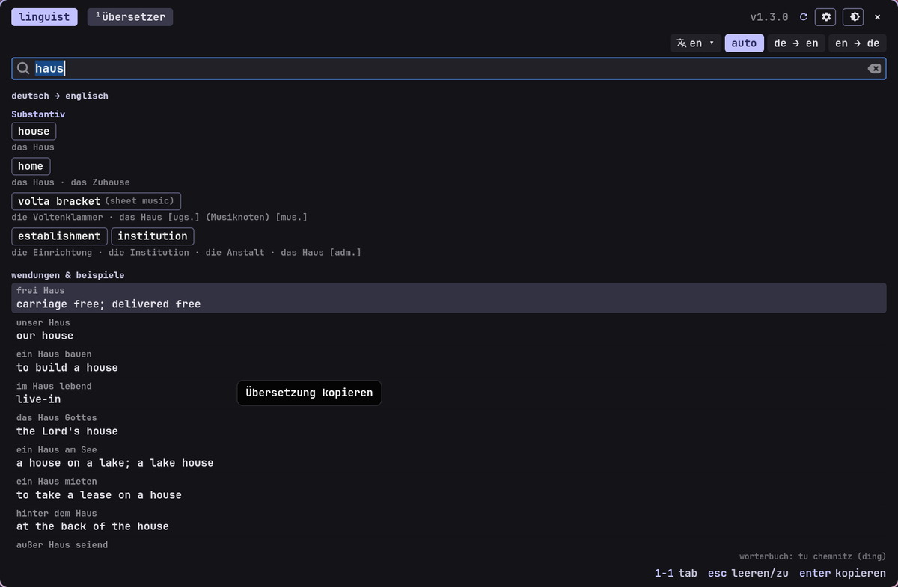

<!-- gh-header -->
<div align="center">


# linguist

**translator with a hover corner**

   

</div>

<p align="center"></p>

<p align="center"><!-- gh-note --><sub>tip: the glass button (󰃝, top right) makes the window see-through, like the terminal – needs a compositor with blur, e.g. hyprland.</sub></p>

the translator of the -ist suite (gtk4): german ⇄ english dictionary offline, more languages to download,
whole sentences online on click. usable as a plain window – but mostly as a **hover translator**: move the mouse
into the bottom right screen corner and the translator card pops up.

## install – linux

```bash
gh auth login                                   # login once (repository is private, invitation needed)
gh repo clone danger-inc/linguist ~/linguist-src
cd ~/linguist-src && ./install.sh
```

the installer asks for the system packages (gtk4, pygobject, gtk4-layer-shell, wl-clipboard – password once),
copies linguist to `~/.local/share/linguist` and creates the command `linguist` and a menu entry. last it asks about
autostart in the background (needed for the screen corner).

## usage

* **window** (`linguist`, best on super+t): type a word or sentence, one click on a translation copies it,
enter copies the first one (or translates online). language and direction at the top; load more languages (wikdict) with a click.
* **hover translator** (settings → *hover-übersetzer*, off by default): move the mouse into the corner and wait
briefly. type, enter/click puts the word at the cursor of the app underneath (󰆏 on the right only copies).
mouse away or esc closes, 󰐃 pins the card. corner, dwell time and "nach dem kopieren zugehen" are adjustable.
* **in the other apps** (notist, mailist): if the hover translator is enabled, the "übersetzer" button shows whether it is
on (click = on/off, right click = settings, ctrl+shift+t = translate the selected text in the card). if it is
off, the button opens the translator inside the app as before.
* commands: `linguist --toggle` (window on/off), `linguist --selection` (translate selected text),
`linguist --popup word`, `linguist --hover on|off|toggle`, `linguist --settings`, `linguist --daemon`, `linguist --quit`.

## runs on

| system | status |
| --- | --- |
| arch (hyprland) | tested |
| sway/kde (layer-shell), ubuntu 24.04+, fedora 40+, openSUSE | should work |
| gnome | window and `--popup` work, the screen corner doesn't (no layer-shell) |

dictionaries: TU Chemnitz "ding" (german ⇄ english, gpl), wikdict/wiktionary (cc by-sa); online sentences via mymemory,
only on click.

## update / remove

```bash
cd ~/linguist-src && ./update.sh
./uninstall.sh
```

<!-- gh-suite -->
## the -ist suite

all apps share one look (terminal style, colors from your wallpaper via matugen), one installer and the same shortcuts.

| app | what it does |
| --- | --- |
| [scourge](https://github.com/danger-inc/scourge-public) | inspect, edit, record, cut – and installs the others |
| [notist](https://github.com/danger-inc/notist-public) | notes · words · latex |
| [filist](https://github.com/danger-inc/filist-public) | file explorer + file dialog |
| [datist](https://github.com/danger-inc/datist) | calendar |
| [mailist](https://github.com/danger-inc/mailist-public) | mail |
| [musicalist](https://github.com/danger-inc/musicalist-public) | youtube music |
| [sharist](https://github.com/danger-inc/sharist) | quick share |
| [wallist](https://github.com/danger-inc/wallist) | wallpapers |
| [inquirist](https://github.com/danger-inc/inquirist) | launcher |

dotfiles with the matching hyprland setup: [danger-inc/dotfiles](https://github.com/danger-inc/dotfiles)
